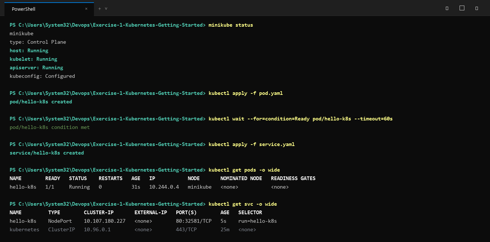

# Exercise 1: Kubernetes – Running Your First Pod

## Objective
Launch a containerised web server inside a Kubernetes cluster and expose it externally through a Service.

## Business Context
This exercise simulates deploying a simple web-facing service (Nginx) on Kubernetes to gain hands-on experience with pod scheduling, service exposure, and basic cluster health verification.

## Architecture & Components
- **Pod**: `my-nginx-pod` — runs the official `nginx` container image on port 80.
- **Service**: `my-nginx-svc` — exposes the Pod on port 80 using a `NodePort` so the application is reachable from outside the cluster.

## Manifests
- `pod.yaml`: Defines the Kubernetes Pod resource.
- `service.yaml`: Defines the Kubernetes Service that forwards traffic to the Pod.

## How to Run

### Option 1: Apply Manifests Directly
```bash
kubectl apply -f pod.yaml
kubectl apply -f service.yaml
```

### Option 2: Use the Deployment Script
- On Linux/macOS/WSL:
  ```bash
  chmod +x deploy.sh
  ./deploy.sh
  ```
- On Windows PowerShell:
  ```powershell
  .\deploy.ps1
  ```

### Check Deployment Status
```bash
kubectl get pods
kubectl get services
```

### Accessing the Running Service
Retrieve the service URL using Minikube:
```bash
minikube service my-nginx-svc --url
```
Or verify the response directly with curl:
```bash
curl $(minikube service my-nginx-svc --url)
```

## Execution Proof & Screenshots

### 1. Pod and Service Deployment


### 2. Service Access & Nginx Verification

