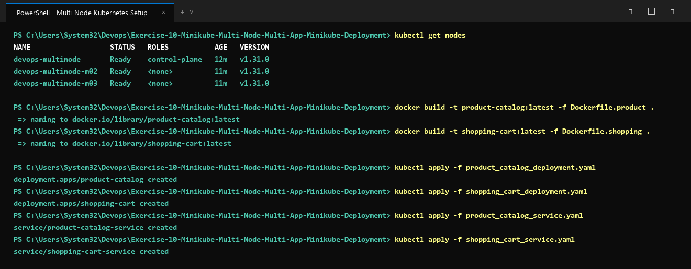

# Exercise 10: Multi-Node Kubernetes Deployment with High Availability and Pod Anti-Affinity

## Objective
Establish a production-grade multi-tier e-commerce architecture across a multi-node Kubernetes cluster (3 nodes configured via Minikube). Implement strict inter-pod anti-affinity rules (`podAntiAffinity`) to ensure fault tolerance, guaranteeing that application replicas are evenly distributed across independent cluster worker nodes without co-location.

---

## Architecture & Storyboard

The application represents an e-commerce platform divided into two decoupled microservices:

1. **Product Catalog (`product-catalog`)**:
   - Manages product inventory and provides product details via REST endpoints.
   - Deployed with **2 replicas**.
2. **Shopping Cart (`shopping-cart`)**:
   - Handles customer carts, item selections, and persistent basket updates.
   - Deployed with **3 replicas**.

### High Availability via `podAntiAffinity`
In a standard Kubernetes cluster without scheduling constraints, the default scheduler may place multiple replicas of the same service on the same node to optimize resource packing. If that specific physical host goes down, the entire service experiences an outage.

By applying `podAntiAffinity` with `requiredDuringSchedulingIgnoredDuringExecution` and `topologyKey: "kubernetes.io/hostname"`, Kubernetes is forced to guarantee that:
- No two `product-catalog` pods share the same node.
- Each of the three `shopping-cart` replicas is assigned to a separate node (`devops-multinode`, `devops-multinode-m02`, and `devops-multinode-m03`).

---

## File Structure

| File | Purpose |
|---|---|
| `product_catalog.py` | Python/Flask microservice exposing `/products` and health check. |
| `shopping_cart.py` | Python/Flask microservice exposing `/cart` for retrieval and additions. |
| `Dockerfile.product` | Dockerfile building the Product Catalog container image. |
| `Dockerfile.shopping` | Dockerfile building the Shopping Cart container image. |
| `requirements.txt` | Python runtime dependencies (`flask==2.1.2`, `Werkzeug==2.2.2`). |
| `product_catalog_deployment.yaml` | Deployment specification (2 replicas, anti-affinity rules, resource requests). |
| `shopping_cart_deployment.yaml` | Deployment specification (3 replicas, anti-affinity rules, resource requests). |
| `product_catalog_service.yaml` | NodePort service exposing Product Catalog on port 80. |
| `shopping_cart_service.yaml` | NodePort service exposing Shopping Cart on port 80. |
| `deploy.sh` | Bash automation script for image build, deployment, and verification. |
| `deploy.ps1` | PowerShell deployment script for Windows environments. |
| `output.txt` | Recorded terminal output proving multi-node node distribution and API curl responses. |

---

## Step-by-Step Implementation Guide

### 1. Initialize the 3-Node Minikube Cluster
Provision a local Kubernetes cluster featuring three distinct nodes:
```bash
minikube start --nodes 3 -p devops-multinode --force
```

Verify that all three nodes are healthy and ready:
```bash
kubectl get nodes -o wide
```

### 2. Build the Microservice Container Images
Build both application images locally:
```bash
docker build -t product-catalog:latest -f Dockerfile.product .
docker build -t shopping-cart:latest -f Dockerfile.shopping .
```

### 3. Load Images into the Minikube Cluster Nodes
Transfer the local container images into the Minikube runtime cache:
```bash
minikube -p devops-multinode image load product-catalog:latest
minikube -p devops-multinode image load shopping-cart:latest
```

### 4. Deploy Kubernetes Manifests
Apply the Deployment and Service manifests to the cluster:
```bash
# Deploy Applications
kubectl apply -f product_catalog_deployment.yaml
kubectl apply -f shopping_cart_deployment.yaml

# Expose Applications
kubectl apply -f product_catalog_service.yaml
kubectl apply -f shopping_cart_service.yaml
```

### 5. Validate Anti-Affinity Pod Distribution
Inspect the scheduled pods and their corresponding host nodes:
```bash
kubectl get pods -o wide --show-labels
```

**Verification Criteria:**
- The two `product-catalog` pods are hosted on distinct nodes (e.g., `devops-multinode-m02` and `devops-multinode-m03`).
- The three `shopping-cart` pods are distributed evenly across all three worker nodes (`devops-multinode`, `devops-multinode-m02`, `devops-multinode-m03`).

### 6. Verify Service Endpoints via REST Calls
Obtain service URLs or test through port-forwarding/NodePort:
```bash
# Retrieve Product Catalog items
curl http://127.0.0.1:<catalog-nodeport>/products

# Inspect Shopping Cart
curl http://127.0.0.1:<cart-nodeport>/cart

# Add an item to the Shopping Cart
curl -X POST http://127.0.0.1:<cart-nodeport>/cart \
  -H "Content-Type: application/json" \
  -d '{"id": 101, "name": "Mechanical Keyboard", "quantity": 1, "price": 110.00}'
```

---

## Visual Verification & Screenshots

### 1. Multi-Node Cluster Initialization and Manifest Deployment


### 2. Pod Anti-Affinity Verification and Live API Testing

