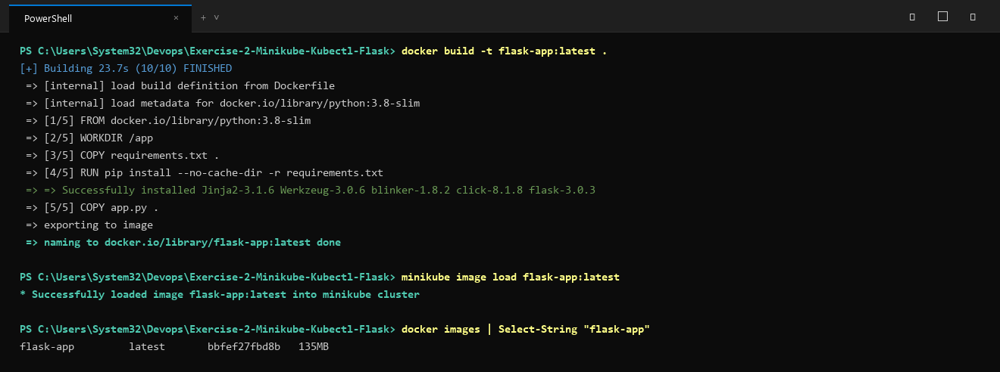

# Exercise 2: Deploy a Python Flask App on Minikube via kubectl

## Objective
Set up a local single-node Minikube cluster and deploy a containerised Python Flask web application using Kubernetes YAML manifests, managing the full lifecycle through `kubectl`.

## Key Concepts
- **`imagePullPolicy: Never`**: Tells Kubernetes to use a locally built Docker image rather than pulling it from a remote registry like Docker Hub.
- **NodePort Service**: Exposes the application externally by mapping an internal container port (5000) to a service port (5000) accessible on the node.

## Architecture
- **Flask App**: Returns `"Greetings from Flask running on Kubernetes!"` on port 5000.
- **Deployment**: `python-flask-app` managing a single replica pod.
- **Service**: `python-flask-svc` exposes port 5000 via NodePort.

## How to Build and Deploy

### 1. Build Docker Image inside Minikube
```bash
# Point local Docker CLI to Minikube's Docker daemon
eval $(minikube docker-env)

# Build the image
docker build -t python-flask-app:latest .
```
*(On Windows PowerShell: `minikube image build -t python-flask-app:latest .` or load via `minikube image load python-flask-app:latest`)*

### 2. Apply Manifests
```bash
kubectl apply -f flask-deployment.yaml
```

### 3. Verify the Deployment
```bash
kubectl get deployments
kubectl get pods -l app=python-flask-app
kubectl get services
```

### 4. Access the Service
```bash
minikube service python-flask-svc --url
```
Test with curl:
```bash
curl $(minikube service python-flask-svc --url)
```

## Execution Proof & Screenshots

### 1. Docker Build and Minikube Image Load


### 2. Kubernetes Deployment, Rollout & Service Verification

