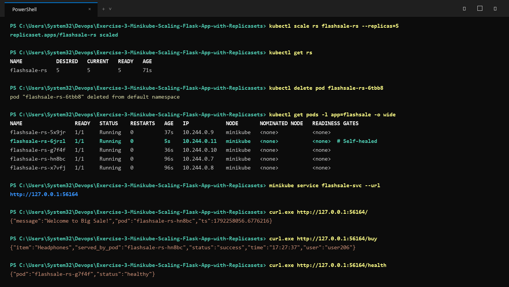

# Exercise 3: Horizontal Scaling of a Flask App using ReplicaSets

## Real-Life Use Case: Online Sale Traffic Surge
During large-scale online sale events (e.g., Amazon Great Indian Festival), web traffic can spike dramatically within seconds. By configuring a Kubernetes `ReplicaSet`, we ensure our application automatically maintains multiple concurrent Pod instances across the cluster, distributing the incoming load evenly and self-healing in case any Pod crashes.

## Architecture
- **Flask App**: Simulates item checkout on the `/order` route, returning the hostname of the serving Pod to demonstrate load balancing. A `/health` endpoint is provided for Kubernetes liveness and readiness probes.
- **ReplicaSet (`sale-rs`)**: Starts with 3 desired replicas, scalable up to 5 or beyond on demand.
- **Service (`sale-svc`)**: Exposes port 80 and routes traffic to port 5000 of the replica Pods.

## Manifests & Files
- `app.py`: Flask application source code.
- `Dockerfile`: Defines the container image.
- `sale-replicaset.yaml`: Kubernetes ReplicaSet and Service manifest.

## Execution & Verification

### 1. Build and Load Image into Minikube
```bash
docker build -t saleapp:1.0 .
minikube image load saleapp:1.0
```

### 2. Apply ReplicaSet and Service
```bash
kubectl apply -f sale-replicaset.yaml
```

### 3. Confirm Pods and Replicas
```bash
kubectl get rs
kubectl get pods -l app=saleapp
```

### 4. Scale Up to 5 Replicas
```bash
kubectl scale rs sale-rs --replicas=5
kubectl get rs
kubectl get pods -l app=saleapp
```

### 5. Verify Self-Healing Behaviour
Delete a pod and watch Kubernetes immediately spin up a replacement to keep the replica count at 5:
```bash
kubectl delete pod $(kubectl get pods -l app=saleapp -o jsonpath="{.items[0].metadata.name}")
kubectl get pods -l app=saleapp
```

## Execution Proof & Screenshots

### 1. Build, Deploy & Verify 3 Replicas


### 2. Scale to 5 Replicas, Self-Healing & Endpoint Load Distribution

