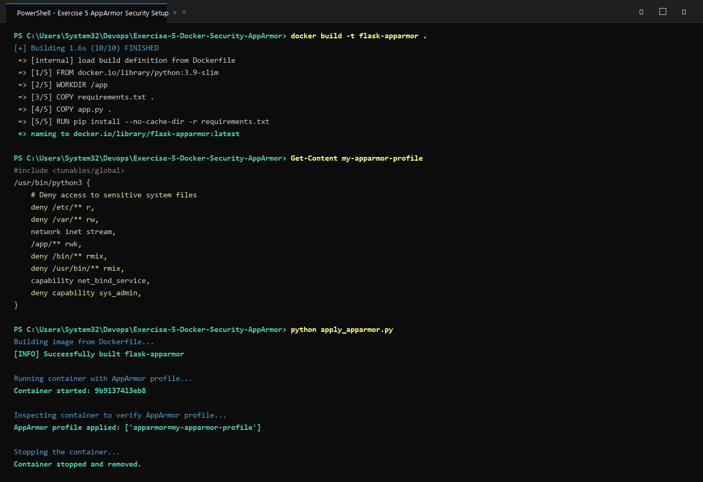

# Exercise 5: Securing Docker Containers using AppArmor Profiles and Python SDK

## Objective
Learn how to harden Docker containers using AppArmor security profiles applied programmatically via the Docker Python SDK. Verify that the confinement rules actively block unauthorised container actions.

## Scenario
Deploying a production-grade Python Flask application that must be hardened against common container security risks:
- Preventing containerised processes from reading sensitive system config files (`/etc/**`).
- Blocking write access to system variable directories (`/var/**`).
- Disallowing execution of system binaries (`/bin/**`, `/usr/bin/**`).
- Restricting Linux capabilities (blocking `CAP_SYS_ADMIN` while allowing `CAP_NET_BIND_SERVICE`).

## Key Concepts
- **AppArmor (Application Armor)**: A Linux Security Module (LSM) that enforces Mandatory Access Control (MAC) on a per-program basis using file-path rules.
- **Docker Security Options (`--security-opt`)**: Allows attaching a named AppArmor profile to a container (`--security-opt="apparmor=secure-flask-profile"`).
- **Docker Python SDK**: Enables container lifecycle management and fine-grained security policy enforcement directly from Python code.
- **Least Privilege Principle**: The container is granted only the minimum set of permissions needed to serve the Flask application.

## Files in this Exercise
- `app.py`: Flask web application to be deployed with security hardening.
- `requirements.txt`: Python dependencies (`flask==2.0.2`, `Werkzeug==2.2.2`, `docker`).
- `Dockerfile`: Container image specification for the Flask application.
- `my-apparmor-profile`: AppArmor profile defining file-access and capability rules.
- `apply_apparmor.py`: Python script using the Docker SDK to build, run, inspect, and verify AppArmor enforcement.
- `test_restricted_actions.py`: Python test script that confirms AppArmor denies reading `/etc/passwd` and executing `/bin/bash`.
- `deploy.ps1`: Automated PowerShell execution script.
- `deploy.sh`: Automated Bash execution script for Linux/WSL environments.
- `output.txt`: Captured execution output confirming security enforcement.

## Execution Steps

### 1. Build the Docker Image
```bash
docker build -t secure-flask .
```

### 2. AppArmor Profile Specification
The profile `my-apparmor-profile` confines `/usr/bin/python3`:
```
#include <tunables/global>

/usr/bin/python3 {
    # Block reads from sensitive system configuration
    deny /etc/** r,
    deny /var/** rw,

    # Allow Flask app to bind to port 5000
    network inet stream,

    # Grant full access to the application working directory
    /app/** rwk,

    # Deny execution of system binaries
    deny /bin/** rmix,
    deny /usr/bin/** rmix,

    # Capability: allow port binding, deny admin-level privileges
    capability net_bind_service,
    deny capability sys_admin,
}
```

### 3. Load Profile on Linux / WSL Host
```bash
sudo apparmor_parser -r /etc/apparmor.d/my-apparmor-profile
```

### 4. Apply Profile Programmatically (Python Docker SDK)
```bash
python apply_apparmor.py
```
Confirms profile attachment in `HostConfig.SecurityOpt`:
```
AppArmor profile applied: ['apparmor=my-apparmor-profile']
```

### 5. Verify Restricted Actions
```bash
python test_restricted_actions.py
```
Expected enforcement output:
- Read `/etc/passwd` → `Exit Code 1, Output: Permission denied`
- Execute `/bin/bash` → `Exit Code 126, Output: Permission denied`

## Questions & Answers

**Q1: Why do we use AppArmor with Docker containers?**  
**A1:** AppArmor enforces mandatory access control at the kernel level, restricting what a containerised process can access. It provides an additional security layer beyond Docker's own isolation, preventing privilege escalation and host filesystem access.

**Q2: How do AppArmor profiles restrict a Docker container?**  
**A2:** Profiles explicitly list what files a program may read/write/execute, which network operations are permitted, and which Linux kernel capabilities are available. Any action not explicitly allowed or explicitly denied is evaluated according to the profile rules.

**Q3: Why is restricting `/etc/` and `/var/` important?**  
**A3:** `/etc/` stores critical system configuration files including user credentials (`/etc/passwd`, `/etc/shadow`). Blocking access prevents a compromised container from leaking credentials or modifying authentication settings. `/var/` contains runtime data that could be exploited for privilege escalation.

**Q4: What other capabilities can AppArmor restrict?**  
**A4:** AppArmor profiles can block any POSIX capability including `cap_net_admin` (network configuration), `cap_raw_io` (raw I/O access), `cap_sys_ptrace` (process tracing), and IPC-related capabilities.

**Q5: How do you confirm that an AppArmor profile is active on a running container?**  
**A5:** Use `docker inspect <container_id>` and check `HostConfig.SecurityOpt` for the value `apparmor=<profile-name>`. The Docker Python SDK's `client.api.inspect_container(id)` returns the same information programmatically.

## Execution Proof & Screenshots

### 1. Docker Build, AppArmor Profile & SDK Deployment


### 2. Security Enforcement & Restricted Action Verification

