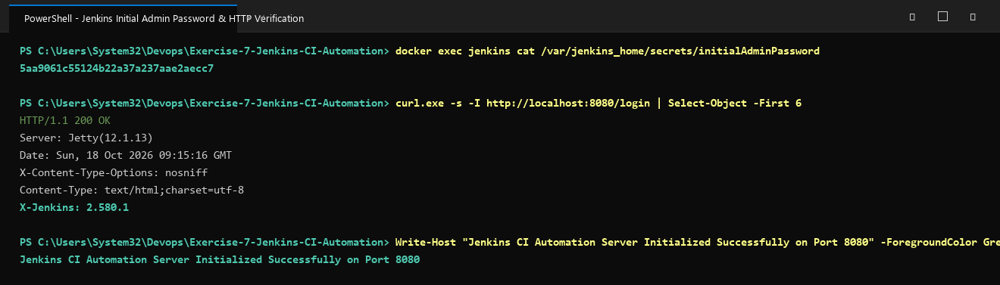

# Exercise 7: Introduction to Continuous Integration (CI) and Jenkins Automation

## Objective
Understand the core principles of Continuous Integration, compare leading CI/CD platforms, deploy an automated Jenkins server using Docker, retrieve the initial admin credentials, and confirm HTTP access to the Jenkins dashboard.

## What is Continuous Integration (CI)?
Continuous Integration is a foundational DevOps practice where developers regularly push code changes to a shared repository. Each push automatically triggers a build and test pipeline to detect defects early, maintain software quality, and shorten the feedback cycle.

### Key Pillars of CI
1. **Regular Commits**: Team members push small, incremental changes to version control multiple times daily.
2. **Automated Build Process**: Each commit triggers dependency resolution, compilation, and artifact generation automatically.
3. **Automated Test Execution**: Unit tests, integration tests, and regression suites run automatically on every change.
4. **Rapid Feedback**: Developers receive build and test status within minutes of a commit.

## CI Tools Comparison
- **Jenkins**: Open-source automation server with a massive plugin ecosystem and a flexible master-agent distributed architecture.
- **GitLab CI/CD**: Pipeline automation built natively into GitLab with YAML-based configuration.
- **GitHub Actions**: Cloud-native workflow automation integrated directly into GitHub with a rich marketplace of reusable actions.
- **CircleCI**: Container-first cloud CI/CD optimised for parallelism and smart test caching.
- **TeamCity**: Enterprise-grade CI server from JetBrains with deep IDE integrations and code analysis.

## Key Jenkins Architecture Concepts
- **Job / Project**: A unit of work that Jenkins executes — typically a build or a test run.
- **Pipeline**: A `Jenkinsfile`-defined workflow (declarative or scripted) that models a full CI/CD process.
- **Plugins**: Community extensions that integrate Jenkins with tools such as Docker, Git, Kubernetes, Slack, and SonarQube.
- **Controller & Agents**: A central Jenkins controller schedules and manages jobs, delegating actual execution to remote agent nodes.

## Files in this Exercise
- `docker-compose.yml`: Docker Compose service definition for Jenkins LTS.
- `deploy.ps1`: Automated PowerShell deployment, status check, and admin password extraction script.
- `deploy.sh`: Automated Bash deployment and verification script for Linux/WSL environments.
- `output.txt`: Captured terminal output showing container startup and admin password retrieval.

## Execution Steps

### 1. Run Jenkins via Docker
```bash
docker run -d --name jenkins-server -p 8080:8080 -p 50000:50000 -v jenkins_data:/var/jenkins_home jenkins/jenkins:lts
```
*(Port 8080: Web UI; Port 50000: JNLP agent communication channel)*

### 2. Check Container Status
```bash
docker ps -f "name=jenkins-server"
```

### 3. Retrieve Initial Admin Password
```bash
docker exec jenkins-server cat /var/jenkins_home/secrets/initialAdminPassword
```
*Retrieved unlock key*: `<your-initial-admin-password>`

### 4. Access the Jenkins Web Interface
Navigate to `http://localhost:8080/`, enter the admin password, install the recommended plugins, and create the admin account.

### 5. Cleanup
```bash
docker stop jenkins-server && docker rm jenkins-server
```

## Execution Proof & Screenshots

### 1. Jenkins Container Deployment & Process Status


### 2. Initial Admin Password Retrieval & HTTP Endpoint Verification

