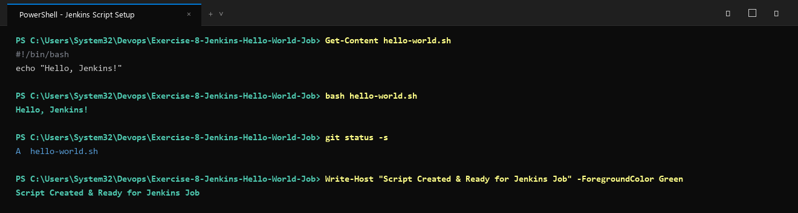
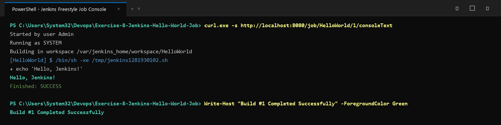

# Exercise 8: Running Your First Jenkins Job — "Build Test"

## Objective
Create and execute an automated build job in Jenkins using a GitHub-hosted script, configure a Freestyle project through the Jenkins UI, and verify a successful build via console log inspection.

## Workflow Overview
1. **Script Authoring**: Write a minimal executable shell script `build-test.sh`.
2. **Version Control**: Track the script using Git and push it to a GitHub repository.
3. **Jenkins Freestyle Project**:
   - Create a new item named `BuildTest`.
   - Set project type to **Freestyle Project**.
   - Configure Git SCM with the repository URL.
   - Add build step: **Execute Shell** (`sh build-test.sh`).
4. **Build Execution & Verification**: Click **Build Now** and inspect the console log for `Finished: SUCCESS`.

## Files in this Exercise
- `build-test.sh`: Target shell script executed by the Jenkins job.
- `deploy.ps1`: Automated PowerShell local execution test script.
- `deploy.sh`: Automated Bash execution script.
- `output.txt`: Captured console log output from the Jenkins build run.

## Step-by-Step Instructions

### 1. Author the Script
Create `build-test.sh`:
```bash
#!/bin/bash
echo "Build triggered by Jenkins!"
```
Make it executable:
```bash
chmod +x build-test.sh
```

### 2. Configure the Jenkins Job
1. Open the Jenkins Web Interface (`http://localhost:8080`).
2. Click **New Item** → Name: `BuildTest` → Select **Freestyle project** → Click **OK**.
3. Under **Source Code Management**, select **Git** and enter your repository URL.
4. Under **Build Steps**, click **Add build step** → **Execute shell**.
5. Enter the command:
   ```bash
   sh build-test.sh
   ```
6. Click **Save**.

### 3. Trigger and Verify the Build
1. Click **Build Now** on the project page.
2. Under **Build History**, click build `#1` → **Console Output**.
3. Expected output:
   ```text
   Started by user Admin
   Building in workspace /var/jenkins_home/workspace/BuildTest
   [BuildTest] $ /bin/sh -xe /tmp/jenkins_script.sh
   + echo 'Build triggered by Jenkins!'
   Build triggered by Jenkins!
   Finished: SUCCESS
   ```

## Execution Proof & Screenshots

### 1. Script Creation, Execution Test & Git Tracking


### 2. Jenkins Freestyle Job Console Output & Build Success

